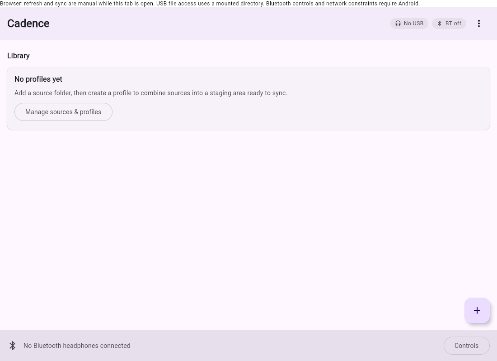
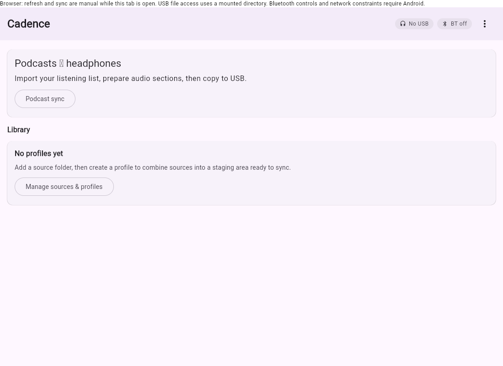

# Podcast preparation and headphone sync

Cadence has two separate operations: importing a listening list/positions and
preparing local files; then copying those prepared files to a mounted headphone
volume. The **Podcast sync** card on the home screen opens the shared Android,
desktop and browser experience. Existing directory profiles remain available.

## What works, and the Pocket Casts blocker

The implementation supports public podcast RSS enclosures and Cadence JSON
snapshots. It does **not** log into Pocket Casts or claim that an import is a live
Pocket Casts account sync. No supported third-party API covering playlist/filter reads, media export and
conditional position writes was verified. The adapter advertises those capabilities as unavailable.

Pocket Casts' own apps synchronize positions, Up Next and other account state.
That does not establish third-party access. Its documented integrations expose
playback intents, shortcuts and subscription links, rather than a general data
API. Its web/desktop New Releases, In Progress and Starred lists also differ from
mobile smart playlists. An OPML subscription export cannot represent the user's
selected episodes and current positions.

Pocket Casts also supports manual playlists and renamed filters to smart playlists
in its own apps; the [official Android changelog](https://github.com/Automattic/pocket-casts-android/blob/main/CHANGELOG.md)
records those features. They do not constitute a public third-party integration.
Its [OPML export](https://support.pocketcasts.com/knowledge-base/exporting-an-opml/)
exports subscriptions rather than selected-episode timelines.

Sources checked 2026-10-26:
[account sync](https://support.pocketcasts.com/knowledge-base/pocket-casts-sync/),
[documented integrations](https://support.pocketcasts.com/knowledge-base/third-party-integration/),
[web/desktop lists](https://support.pocketcasts.com/knowledge-base/desktop-app/).

### Read-only web-session investigation

Pocket Casts' current [playlist documentation](https://support.pocketcasts.com/knowledge-base/playlists/)
confirms manual playlists on the web, but states there is no playlist sharing/export
link. A playlist RSS feed is therefore not a documented route. This does not mean
its internal account APIs are inaccessible from the user's own signed-in browser.

The published [Android service contract](https://github.com/Automattic/pocket-casts-android/blob/main/modules/services/servers/src/main/java/au/com/shiftyjelly/pocketcasts/servers/sync/SyncService.kt)
exposes read endpoints `/user/playlist/list`, `/user/podcast/episodes` and
`/user/episodes`. Its [protobuf schema](https://github.com/Automattic/pocket-casts-android/blob/main/modules/services/protobuf/src/main/proto/sync_api.proto)
contains playlist episode order/membership and episode URL, duration and playback
position fields. These are promising for an experimental **one-way import** from
an authorized browser session, even without a supported public integration.
Manual playlist membership and smart-playlist filter rules must be distinguished;
a rules response alone is not a resolved episode list. Live web requests still
need to be inspected: this session's browser received Pocket Casts' 403 page before
login. No authenticated account read is claimed from source inspection alone.

**Recommendation:** investigate one-way browser-session export first; for a durable
account integration, ask Pocket Casts for an authorized integration providing
playlist membership, episode IDs, enclosure access, position reads, and
conditional/idempotent position writes. Use public RSS in the meantime. Cadence
must not reuse private app credentials or reverse-engineered account endpoints
as though they were a supported public API. An explicitly user-authorized
experimental browser import must be labelled as such and keep credentials inside
that browser session. Live account behavior remains an
external blocker, not a hidden experimental login feature.

| Backend | Selection/positions | Exportable audio | Implemented |
| --- | --- | --- | --- |
| Pocket Casts | Own-app sync exists; third-party access unverified | Public podcast enclosures may be independently accessible | Capability-gated adapter; manual snapshot input only |
| Public RSS | Feed items; no account position service | HTTPS, unencrypted enclosures with permission to download | Feed import/refresh, download and preparation |
| Cadence JSON snapshot | Explicit selected episodes, positions and revisions | Authorized HTTPS enclosure supplied by user | Import, validation, preparation |
| Spotify | OAuth playlist metadata and some resume-point reads | API forbids facilitating content downloads; previews are not full episodes | No export adapter |
| Audible | Vendor account and compatible-device flows | Protected vendor downloads require supported devices | No export or DRM conversion adapter |

Spotify's [playlist API documentation](https://developer.spotify.com/documentation/web-api/reference/get-playlist)
explicitly prohibits content downloading. A public podcast also listed on Spotify
can be imported independently through its publisher's RSS feed; this is not an
export of Spotify audio. Audible's
[AudibleSync workflow](https://help.audible.com/s/article/listen-with-audiblesync?language=en_US)
is Windows-specific and limited to supported devices. Cadence does not decrypt
or repackage protected audio. Audiobookshelf and gPodder-compatible servers are
reasonable future backend candidates, but no credentials/server were supplied
and no adapter for them is claimed here.

## Use the workflow

1. Open **Podcast sync**. Enter a public HTTPS RSS feed and choose **Sync RSS to
   app**, or paste a Cadence snapshot below. RSS items must include enclosure URLs
   and `itunes:duration`; a feed missing durations needs an explicit snapshot.
   RSS has no account position, so first import starts at zero. Refresh retains
   Cadence's contiguous position for the same episode/audio version.
2. Choose splitting at the imported position, an optional chunk duration
   (1–120 minutes; 0 disables chunks), and chunk format. Turn off both splitting
   options to retain the original unsplit file. Choose **Download & prepare**.
3. Review the generated sections. **Mark played** records a durable local
   acknowledgement. It does not claim the backend was updated.
4. Connect the headphones, let the OS mount the storage volume, and use
   **Choose headphone volume**. Choose the volume root, not an existing music
   folder. Then **Copy prepared audio to USB**.

A 60-minute episode at 30 minutes produces `[0,30)` and `[30,60)` sections. With
five-minute chunks, each side is subdivided. Irregular boundaries and short tails
are retained. Every section records original episode identity, immutable audio
version and exact start/end milliseconds. IDs are SHA-256 over that identity and
range; filenames include a safe title and a padded starting offset so sections
of an episode sort in timeline order. Playlist ordering between different episodes
is not enforced by headphone firmware. Encoded audio has codec frame/encoder-delay
rounding; offsets remain the intended source timeline rather than an assertion
of sample-perfect MP3 boundaries.

### Platform support

| Platform | Local preparation | USB copy |
| --- | --- | --- |
| Android (current app minimum API 34) | Original unsplit audio; Media3 Transformer clips to AAC/M4A | System document picker/SAF, if Android exposes the mounted volume; OTG/host hardware required |
| Desktop (Linux/macOS/Windows) | Original unsplit audio; FFmpeg clips to MP3 or AAC/M4A | OS-mounted writable directory; no raw device writes |
| Web | Original unsplit audio to OPFS; RSS/media servers must allow CORS | HTTPS/localhost and desktop Chrome/Edge File System Access picker |
| iOS | No app target in this repository | Unsupported |
| Firefox/Safari/mobile browsers | Download/import depends on browser storage and CORS | Writable mounted-directory workflow unsupported |

Install FFmpeg separately on desktop and make `ffmpeg` available on `PATH`; it is
not bundled into installers. Android uses `androidx.media3:media3-transformer`
1.11.1, clipping configuration, video removal and AAC encoding, on the application
looper. Its default MP4 muxer produces real M4A files. Export cancellation cancels
the transformer, and partial output is never marked ready. See Android's
[clipping/transcoding guide](https://developer.android.com/media/media3/transformer/transformations)
and [supported formats](https://developer.android.com/media/media3/transformer/supported-formats).
Android does not promise MP3 encoding. **Check AAC/M4A support on the actual
headphones** before choosing it; use desktop MP3 preparation for MP3-only devices.
Cloud currently syncs manifests, not generated audio, so a phone cannot retrieve
desktop MP3 chunks through cloud sync.

All operations are foreground/manual. Keep the app/tab open; no background
podcast worker is advertised. Browser requests omit ambient cookies and reject
redirects; feeds or enclosures that depend on redirects need a direct HTTPS URL
or preparation on desktop/Android. Native media downloads follow at most five
HTTPS redirects without account headers. Downloads reject empty/non-audio content
and have a 2 GB per-file limit. There is no protected streaming/HLS/DRM export.

### Snapshot format

This is a **Cadence interchange format**, not a Pocket Casts export format. A
user-supplied/authorized integration would have to produce it. The example URL
is illustrative and is not a downloadable fixture:

```json
{
  "schema": 1,
  "name": "Wanted on headphones",
  "episodes": [{
    "backend": "pocket-casts",
    "id": "original-episode-id",
    "title": "An hour-long episode",
    "audioUrl": "https://publisher.example/episode.mp3",
    "durationMs": 3600000,
    "positionMs": 1800000,
    "revision": "observed-position-revision",
    "audioVersion": "immutable-media-version",
    "extension": "mp3"
  }]
}
```

`revision` identifies observed backend state; `audioVersion` identifies the media
whose offsets were measured. Never reuse an audio version after media changes.
RSS uses enclosure URL and declared length as a best-effort version fingerprint;
this cannot detect all dynamic advertising changes. Use versioned snapshots for
feeds with changing ads. Credentials must not be embedded in URLs. Cloud metadata
contains the playlist URLs/history; use public media URLs unless you deliberately
accept storing private URLs in your own account. Files and metadata accumulate
locally; automatic cache eviction is not implemented.

## Playback acknowledgements and conflicts

Completions form an idempotent, grow-only set of section IDs. Marking the same
section twice does not duplicate progress. Starting from the imported backend
position, only contiguous completed intervals advance the local position. A later
chunk can be acknowledged first without skipping an unplayed gap. A different
audio version cannot advance the old media's position. Acknowledgements also record
the observed backend revision. A fresh snapshot with a new revision respects an
explicit backend rewind; old acknowledgements are retained as history and cannot
automatically advance the new revision.

`PodcastBackend` separates playlist enumeration, snapshot reads, capability flags
and conditional/idempotent position writes. A future write-capable adapter must
use `expectedRevision` and a stable `operationId`, re-read on conflict, and expose
rewinds/reset decisions rather than overwrite them. This release has no verified
write-capable provider: acknowledgements remain local/cloud metadata, and the UI
says **Backend writes unavailable**. Mobile backend position writes are therefore
an external integration blocker, not a completed feature.

## Safe device folder ownership

Only `Cadence/podcasts` beneath the selected volume is used by this workflow.
An empty folder receives `.cadence-owner` containing `cadence-podcasts-v1`. An
existing nonempty folder without that marker is refused. Nothing outside that
folder is deleted or replaced. Existing Cadence sections are retained, including
obsolete sections, so an incremental refresh cannot delete personal files.
Desktop also rejects symlinks in the owned path. Directory selection grants
filesystem access; USB discovery does not grant a mount path or access to the
protected mass-storage interface.

The device receives audio and `cadence-manifest.json` with opaque episode keys and
timeline ranges. The app/cloud library maps those keys back to original backend
episode IDs; raw provider IDs are omitted from USB because RSS GUID fallbacks can
contain private URLs. Account credentials, cloud settings and enclosure download URLs
are omitted. The manifest is written last. Desktop uses temporary files before
replace; browser writes use File System Access commit semantics. SAF cannot
promise atomic replacement: unplugging may leave a partial file, and the app
reports failure without marking the transfer complete. Retry before listening.
Firmware does not report played chunks back; marking played is an explicit app
action. Safe eject remains the OS's responsibility.

## Optional cross-device persistence

**Chosen approach:** Supabase Postgres + Auth for small metadata documents, with
operator-applied [SQL setup](../cloud/supabase.sql). This uses the same HTTPS REST
RPC and password auth calls on all three platforms, avoids platform-specific cloud
SDKs, and gives explicit per-user row-level security and atomic revision checks.
Firebase would also work, but its platform SDK differences add integration work
for Kotlin/Wasm; a bespoke server would add hosting/auth maintenance. Supabase is
a recommendation and optional adapter, not a provisioned service.

The document includes the listening list, RSS feed selection, segmentation configuration, source
positions, manifests, played-section acknowledgements and last import timestamp.
Device mount paths, directory permissions, available-file IDs and copied-file IDs
stay local. Restoring a manifest on another device never claims its audio is
already downloaded; preparation must run there. No audio is uploaded, minimizing
storage, transfer costs and redistribution concerns. Adding encrypted cloud audio
storage is a separate product/licensing/cost decision.

Setup (requires the project owner's action; not performed by this change):

1. Create/select a Supabase project and review its region/privacy requirements.
   Run `cloud/supabase.sql` in its SQL editor. Do not disable RLS.
2. Configure email/password Auth and create/confirm the user's account using your
   chosen account enrollment flow. Cadence currently provides sign-in, not account
   registration/password recovery. A production public product should add a
   reviewed enrollment and PKCE/OAuth flow before wider distribution.
3. In each Cadence app, enter the HTTPS project URL and **publishable/anon** key.
   Never use a service-role or secret key. Sign in with the same account. Passwords
   and access tokens are memory-only, with no token logging or cloud serialization.
   Sign out discards the in-memory session while retaining the local library.
   Sign in again after restarting or token expiry. No refresh token is persisted.
4. **Save to cloud** creates a document at revision 1. Another device signs in and
   chooses **Restore cloud configuration & merge played sections**, then prepares
   its own audio. That action explicitly adopts remote configuration and unions
   played acknowledgements. Save again to upload the union.
5. Concurrent saves use compare-and-set on `revision`. A stale writer gets HTTP
   409; local state is retained. Restore remote configuration, reapply desired
   settings, and retry. No wall-clock last-writer-wins overwrite is used. A response
   lost after server commit may require the same restore/retry recovery.

The free plan currently includes 500 MB database storage, 50,000 monthly active
users and 5 GB egress, and pauses projects after one week of inactivity. Pro starts
at $25/month; review current quotas and pricing before provisioning. This feature
needs no paid plan for small personal metadata use, but free service availability
is not guaranteed. No project, billing plan or deployment was created. Source:
[Supabase pricing](https://supabase.com/pricing). The
[RLS guide](https://supabase.com/docs/guides/database/postgres/row-level-security)
explains why grants as well as policies are restricted in the setup SQL.

Local state is `~/.cadence/podcasts/library.json` on desktop, private app files on
Android, and `cadence-podcasts-v1` localStorage plus OPFS audio on web. Browser
storage is origin-specific and subject to quota/eviction. The Android **Podcast
sync** home-screen widget shows last import/operation status and whether actual
local sections are ready for a device copy. Tap it to open Cadence; it does not
start background network work or claim the headphones are attached.

## Verification

Automated checks cover segmentation boundaries, out-of-order and duplicate played
acknowledgements, media-version isolation, durable restoration/readiness checks,
failed preparation, cloud payload separation, revision failure preservation,
actual FFmpeg M4A/MP3 exports, timeline filename order, owned-folder copying,
symlink rejection and browser folder safety. `tests/cloud-persistence.test.cjs`
executes the setup SQL in PGlite Postgres, testing anonymous denial, two-account
RLS isolation and revision conflicts without provisioning a cloud service.

```sh
./gradlew :shared:desktopTest :composeApp:assembleDebug :composeApp:testDebugUnitTest :composeApp:lintDebug
./gradlew :shared:wasmJsBrowserDistribution ktfmtCheck
node --test tests/browser-platform.test.cjs
npm install --prefix /tmp/cadence-cloud-tests @electric-sql/pglite@0.5.11
NODE_PATH=/tmp/cadence-cloud-tests/node_modules node tests/cloud-persistence.test.cjs
```

`Media3ClippingTest` is a real-device Android instrumentation check: it generates
PCM input and checks AAC output format/duration and original section mapping.
Run on a connected API-34+ Android device/emulator using `./gradlew :composeApp:connectedDebugAndroidTest`. Compilation alone does not verify codecs,
SAF device providers, widget rendering, USB permission behavior or headphone
firmware. These need a hardware check. Live Supabase Auth/REST and Pocket Casts
account integration need credentials/provider support; local SQL validation is
not a claim that those live flows were exercised.


The optional production browser smoke uses a generated two-second tone (no external
media) and intercepts only its enclosure URL. Serve the production distribution as
in the main README, install Playwright outside the repository, and run:

```sh
NODE_PATH=/tmp/cadence-tools/node_modules node tests/podcast-ui-smoke.cjs
```

The checked-in tone was generated with FFmpeg's sine source at 440 Hz, two seconds,
44.1 kHz, MP3 64 kbps. No podcast audio is checked into this repository.


A separate pre-existing shared-module device-test resource task fails before test
compilation (`CopyResourcesToAndroidAssetsTask.outputDirectory` is unset), also
reproduced with the original shared build configuration. It is tracked as
[SCH-57](https://linear.app/yschimke/issue/SCH-57/cadence-shared-android-device-tests-fail-before-compilation-compose).
The new Media3 instrumentation test lives in the app's existing Android test
suite; `:composeApp:assembleDebugAndroidTest` compiles it without that broken task.

### Session verification record (2026-10-26)

- Passed: 16 shared desktop tests, including actual FFmpeg MP3/M4A clipping and
  cloud restore/revision behavior and URL-free USB manifests; no skipped tests.
- Passed: Android debug APK and app instrumentation APK assembly, Android lint,
  desktop JAR, production Wasm distribution, and `ktfmtCheck`.
- Passed: nine browser adapter tests; local PGlite/Postgres auth isolation/CAS
  checks; the new podcast browser smoke and existing USB/unsupported-browser smoke.
- Android unit-test task reported `NO-SOURCE`; it is not counted as executed tests.
- Not run locally: connected Android codec/widget/SAF tests, physical headphone
  playback/copying, live cloud Auth/REST.
- Passed in the first PR CI run: `Media3ClippingTest` on an API-34 emulator, with
  one codec test and one app-launch test, zero failures and zero skipped tests.
  [Instrumentation run/report](https://github.com/yschimke/cadence/actions/runs/40303267743)
  at commit `43eca08`; this does not replace a physical-headphone check.

Before is the published main app; after images are from the locally built
production Wasm app using generated test audio. The mobile image is a responsive
browser render, not a claim of an Android device screenshot.

| Before | After home |
| --- | --- |
|  |  |

[Prepared sections and acknowledgement](podcast-sync/after-sections.png) ·
[Imported snapshot](podcast-sync/after-podcast.png) ·
[Mobile-width browser](podcast-sync/after-mobile.png) ·
[Dark theme](podcast-sync/after-dark.png)
